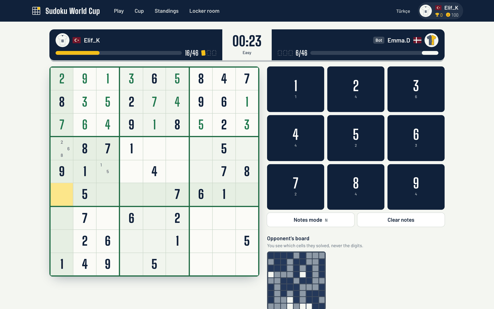
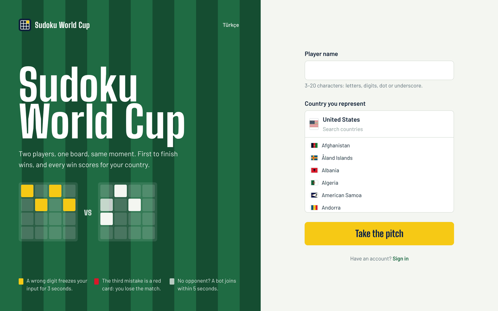
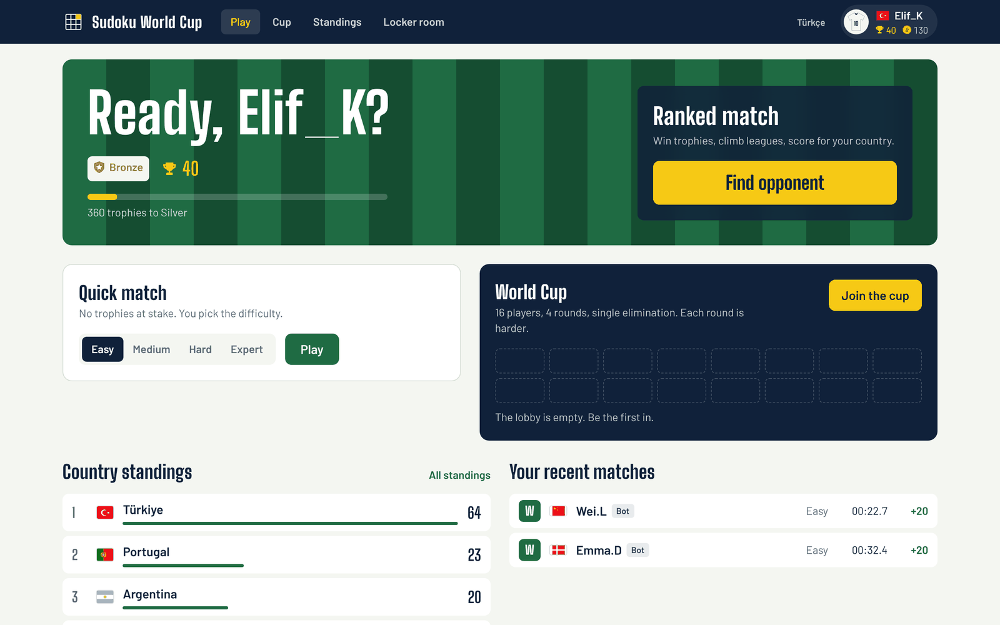
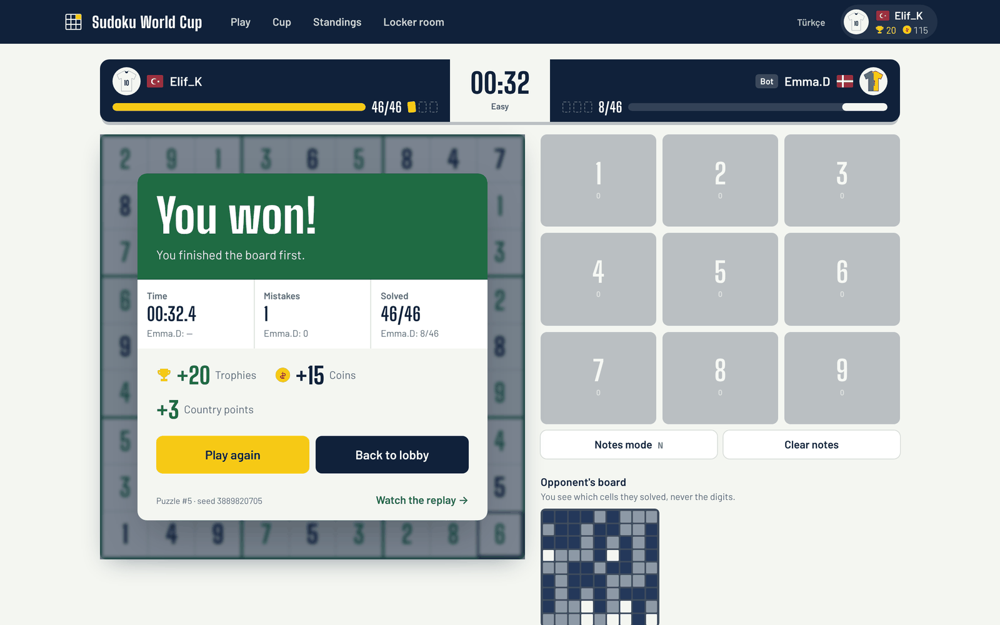
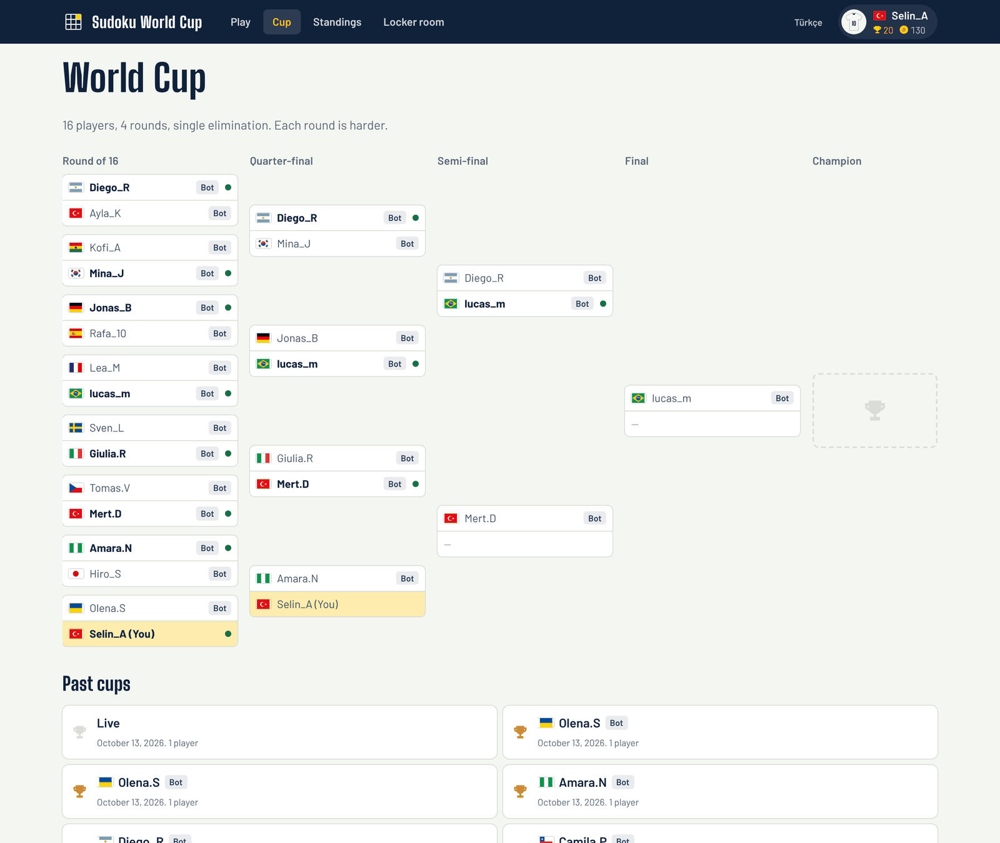
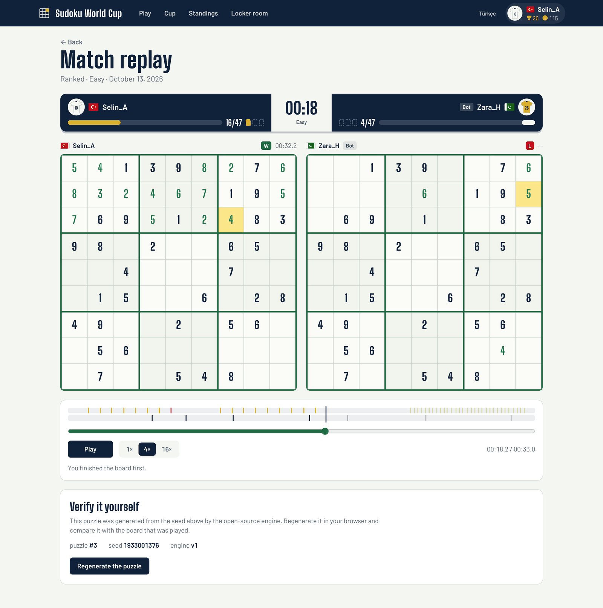
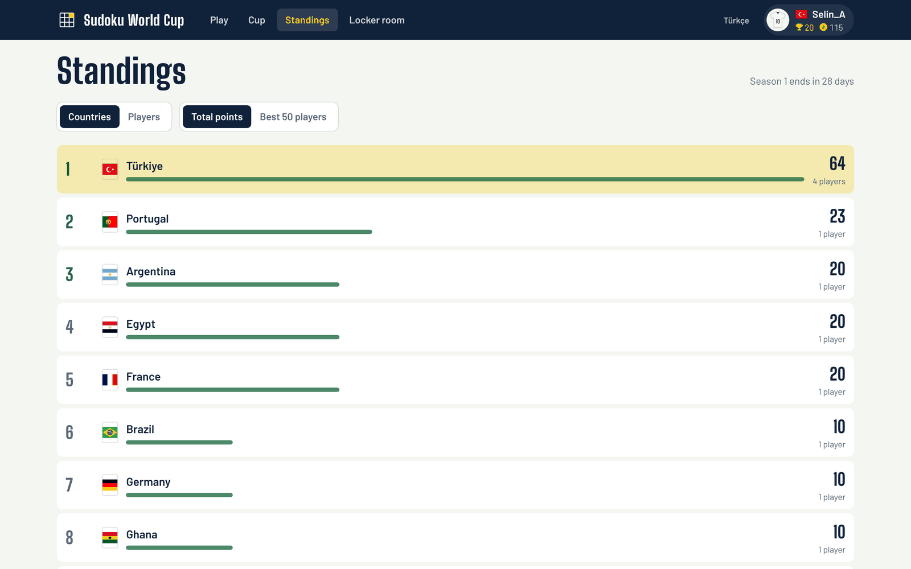
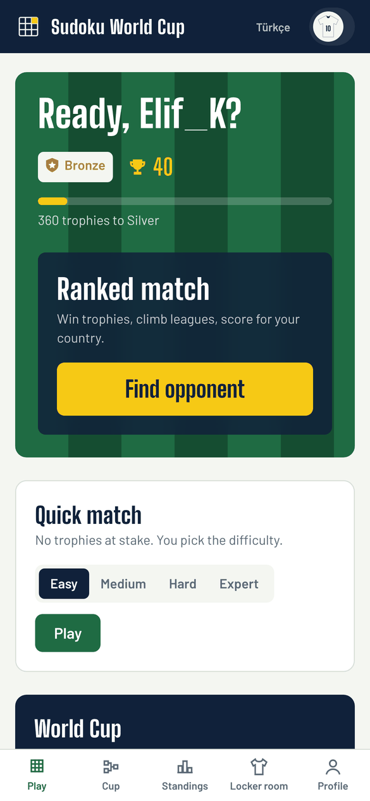

<div align="center">


# Sudoku World Cup

**Real-time 1v1 Sudoku races, knockout cups and a country leaderboard.**
Two players get the same board at the same moment. First to finish wins, and every win scores for your country.

[](https://github.com/efeertureten/sudoku-world-cup/actions/workflows/ci.yml)
[](LICENSE)
[](CONTRIBUTING.md)

[](https://codespaces.new/efeertureten/sudoku-world-cup?quickstart=1)

[Türkçe](README.tr.md) · [Architecture](docs/ARCHITECTURE.md) · [Socket protocol](docs/PROTOCOL.md) · [Contributing](CONTRIBUTING.md)



</div>

## Features

- **Head-to-head races.** Both players solve the same unique-solution puzzle; the server validates every digit. A wrong digit freezes your input for 3 seconds, and the third mistake is a red card.
- **Instant matchmaking.** Rating-based queues whose search window widens while you wait. If nobody turns up within 5 seconds, a human-like bot (always labelled as a bot) takes the other seat.
- **World Cup knockouts.** 16-player single-elimination cups, seeded by trophies, harder puzzle every round, bots fill empty seats.
- **Country leaderboard.** Wins score points for the country you represent, by total or by each nation's best 50 players. Wins against bots count a little, with a daily cap, so small servers have a living table that nobody can farm.
- **Public replays.** Every finished match gets a shareable replay of both boards side by side, and a button that regenerates the puzzle from its seed in your browser to prove it was fair.
- **Progression.** Trophies and six leagues, coins, and unlockable board themes and kits defined as plain JSON.
- **Fair by design.** Solutions and seeds never reach the browser during a match, moves are validated atomically in Redis, and finished matches are published with their seed so anyone can verify them.

## Try it in your browser

No installation: press **Open in GitHub Codespaces** above and wait about two minutes. The codespace builds and starts the whole stack, then opens the game on port 8080 (if it does not, open the **Ports** tab and click the globe next to 8080).

- **Play a bot:** press *Find opponent*; a bot joins after 5 seconds.
- **Play a person:** open the same address in a private window and queue from both, or set port 8080 to *Public* in the Ports tab and send the link to a friend.
- **Play a cup:** press *Join the cup*; bots fill the empty seats after 60 seconds.

## Quick start

You need Docker with Compose v2.

```bash
git clone https://github.com/efeertureten/sudoku-world-cup.git
cd sudoku-world-cup
docker compose up --build
```

Open **http://localhost:8080**, pick a name and a country, and press *Take the pitch*. The first start builds the images and generates the puzzle pool; later starts take seconds.

No `.env` file is needed. Copy [`.env.example`](.env.example) to `.env` to change the port, credentials or game tuning (bot delay, match time limit, cup fill time).

## Local development

Requirements: Node.js 22, pnpm 10 (`corepack enable`), Docker for Postgres and Redis.

```bash
pnpm install
pnpm infra:up        # Postgres :5432 and Redis :6379
pnpm dev             # API on :3000, web on http://localhost:5173 with hot reload
```

| Command | What it does |
| --- | --- |
| `pnpm check` | Lint, typecheck and run every test (integration tests need `pnpm infra:up`) |
| `pnpm build` | Production builds of the server bundle and the web app |
| `pnpm db:generate` | Create a SQL migration after editing `apps/server/src/db/schema.ts` |
| `pnpm --filter @swcup/engine bench` | Measure puzzle generation speed per difficulty |

## How it fits together

```
apps/web        React + Vite + Tailwind + Motion (formerly Framer Motion) client
apps/server     Express REST API, Socket.io gateway, match engine, bots, cups (+ puzzle worker)
packages/engine Zero-dependency Sudoku generator, solver and human-technique grader
packages/shared Socket event contracts, zod schemas, rules, leagues, countries, cosmetics
content/        Board themes and kits as JSON (no code needed to add one)
infra/docker    Dockerfiles and the Caddy config that serves the app on one origin
```

PostgreSQL stores players, matches, ledgers and the puzzle bank. Redis holds everything live: sessions, queues, match state, lobbies and a durable timer wheel. Read [docs/ARCHITECTURE.md](docs/ARCHITECTURE.md) for the full picture and the reasoning behind each choice.

## Screenshots

| Welcome | Lobby | Full time |
| --- | --- | --- |
|  |  |  |
| **Knockout bracket** | **Replay and verification** | **Country standings** |
|  |  |  |

<p align="center"></p>

## Fair play

A computer solves Sudoku in milliseconds, so no client-side trick can stop someone from consulting a solver. The project's answer, explained in [docs/ARCHITECTURE.md](docs/ARCHITECTURE.md#fair-play):

1. The solution and the generator seed stay on the server until the match ends.
2. Every move goes through one atomic Lua script: rate limit, penalty lock, validation and the winner decision.
3. After each match a behavioural analyser scores timing regularity, fill order and whether each digit was deducible from the player's own board. Suspicious matches hold their country points until a person reviews them.

Found a way around it? Please report it privately, see [SECURITY.md](SECURITY.md).

## Roadmap

- [x] 1v1 ranked and quick matches, bots, reconnects
- [x] 16-player knockout cups
- [x] Trophies, leagues, coins, themes and kits
- [x] Country leaderboard with live updates
- [x] Public replays with in-browser puzzle verification
- [ ] Friend challenges with a shareable link
- [ ] Spectating live matches
- [ ] More languages (add one in `apps/web/src/lib/i18n.ts`)

## Contributing

Bug fixes, translations, new board themes and kits are all welcome. Start with [CONTRIBUTING.md](CONTRIBUTING.md); issues labelled `good first issue` are a good entry point.

## License and credits

[MIT](LICENSE). Flags from [flag-icons](https://github.com/lipis/flag-icons) (MIT). Fonts: Big Shoulders Display and Barlow (SIL Open Font License), self-hosted via Fontsource.

This is a fan project with a football theme. It is not affiliated with, endorsed by or connected to FIFA or any football federation, and it uses none of their names, emblems or trophies.
